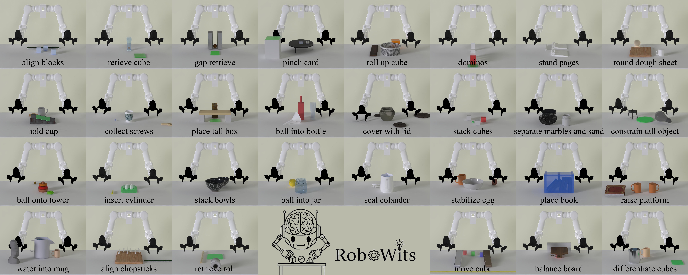

<p align="center">
  <h1 align="center">RoboWits: Unexpected Challenges for Robotic Creative Problem Solving</h1>
  <p align="center">
    NeurIPS 2026 Evaluations &amp; Datasets Track
  </p>
  <p align="center">
    <a href="https://chunru-lin.github.io/">Chunru Lin</a><sup>*</sup>,
    <a href="https://icefoxzhx.github.io/">Hongxin Zhang</a><sup>*</sup>,
    <a href="https://ario-photography.netlify.app/dist/about_me">Fenghao Yu</a>,
    <a href="https://acmlczh.github.io/">Zhehuan Chen</a>,
    <a href="https://cocosci.princeton.edu/tom/index.php">Thomas L. Griffiths</a>,
    <a href="https://yejinc.github.io/">Yejin Choi</a>,
    <a href="https://davheld.github.io/">David Held</a>
    <a href="https://people.csail.mit.edu/ganchuang/">Chuang Gan</a>
  </p>
  <p align="center">
    <a href="https://arxiv.org/abs/2605.30326">
      
    </a>
    <a href='https://umass-embodied-agi.github.io/RoboWits/' style='padding-left: 0.5rem;'>
      
    </a>
    <a href='https://huggingface.co/datasets/XHRlyb2001/RoboWits_lerobot_dataset' style='padding-left: 0.5rem;'>
      
    </a>
  </p>
</p>

**RoboWits**, a bi-manual robotic benchmark designed to systematically evaluate cognitive reasoning, creative tool use, and robustness to unexpected conditions.

<p align="center">
    
</p>

<br>

<!-- TABLE OF CONTENTS -->
<details open="open" style='padding: 10px; border-radius:5px 30px 30px 5px; border-style: solid; border-width: 1px;'>
  <summary>Table of Contents</summary>
  <ol>
    <li>
      <a href="#news">News</a>
    </li>
    <li>
      <a href="#installation">Installation</a>
    </li>
    <li>
      <a href="#quick-start">Quick Start</a>
    </li>
    <li>
      <a href="#benchmark">Benchmark</a>
    <li>
      <a href="#acknowledgement">Acknowledgement</a>
    </li>
    <li>
      <a href="#citation">Citation</a>
    </li>
  </ol>
</details>

## News
- [2026-11-09] Release the VLM baselines implementation, add bimanual AgileX Piper robot support, and Fable 5.2 and GPT-6 Astra results.
- [2026-09-27] RoboWits now runs on Genesis World 1.3.1, with its latest physics and rendering. The latest full benchmark is updated now.
- [2026-09-24] RoboWits is accepted to the **NeurIPS 2026 Evaluations & Datasets Track**!
- [2026-06-04] We release the Benchmark code, along with the [dataset](https://huggingface.co/datasets/XHRlyb2001/RoboWits_lerobot_dataset) consisting of ~50 demonstrations on 24 seed tasks for fine-tuning!
- [2026-05-30] RoboWits is on [arXiv](https://arxiv.org/abs/2605.30326)! Check out our [project website](https://umass-embodied-agi.github.io/RoboWits/) for videos.


## Installation

### Dependencies

Install [uv](https://docs.astral.sh/uv/getting-started/installation/) if you haven't already.

```bash
# Fetch the patched LeRobot and Genesis submodules (third_party/lerobot, third_party/genesis).
# Not --recursive: that also clones Genesis's docs, LuisaRender and ParticleMesher, which gs-gym does not need.
git submodule update --init

uv sync
source .venv/bin/activate
```

### Assets

Some assets come from [BlenderKit](https://www.blenderkit.com/) and require an API key to download, which can be found in your [profile](https://www.blenderkit.com/profile/addon/). Some BlenderKit assets are only available in `.blend` format — the download script converts them to GLB automatically by invoking Blender as a subprocess.

#### Install Blender

Make sure Blender is installed and available on your `PATH`:

```bash
# macOS (Homebrew)
brew install --cask blender

# Or download from https://www.blender.org/download/ and add to PATH
echo 'export PATH="/Applications/Blender.app/Contents/MacOS:$PATH"' >> ~/.zshrc && source ~/.zshrc

# Ubuntu (headless) — download the latest tarball from https://www.blender.org/download/
wget https://mirrors.dotsrc.org/blender/release/Blender5.1/blender-5.1.2-linux-x64.tar.xz
tar -xf blender-5.1.2-linux-x64.tar.xz -C /opt
echo 'export PATH="/opt/blender-5.1.2-linux-x64:$PATH"' >> ~/.bashrc && source ~/.bashrc

# Verify
blender --version
```

#### Prepare Assets

```bash
bash assets/setup_assets.sh --api-key <BLENDERKIT_API_KEY>
```

> **Note:** Some assets require a BlenderKit full-plan subscription. If your API key is a free-tier key, downloads for paid assets will be skipped automatically and those tasks will be unavailable.

The directory should look like:

```
assets/
  hf_assets/
    work_table.glb
    marvin_bimanual/
      ...
    piper_description/      # bimanual_piper robot
      ...
    envmap/                 # Nyx environment maps (*.exr)
      ...
    worktable_texture/
      grained black plastic_Normal.jpg
      grained black plastic_Roughness.jpg
    ...
  blender_kit/
    <asset-id>/
      obj.glb
    ...
```

## Quick Start

### Run the environment

```bash
python scripts/robowits/examples/run_env.py 
```

### Available Tasks

```python
import gs_gym

# List all tasks
print(gs_gym.list_tasks())

# List tasks by benchmark
print(gs_gym.list_tasks(benchmark="robowits"))

# List all benchmarks
print(gs_gym.list_benchmarks())
```

### Observation Modes

Configure via `observation_mode` parameter:

| Mode | Dim | Contents |
|------|-----|----------|
| `"EE"` (default) | 14D | Right EE pos (3) + left EE pos (3) + right rot axis-angle (3) + left rot axis-angle (3) + grippers (2) |
| `"EE_ROT6D"` | 20D | Right EE pos (3) + left EE pos (3) + right rot6d (6) + left rot6d (6) + grippers (2) |
| `"JOINT"` | 16D | Right joints (7) + right gripper (1) + left joints (7) + left gripper (1) |

`rot6d` is the first two **rows** of the rotation matrix flattened row-major,
`[R00, R01, R02, R10, R11, R12]` — a continuous parameterization that avoids the discontinuity
axis-angle has near ±π. EE positions are robot-base-relative in every EE mode.

### Control Modes

Configure via `control_mode` parameter:

| Mode | Dim | Description |
|------|-----|-------------|
| `"EE_ABS"` (default) | 14D | Absolute end-effector pose, axis-angle rotation (IK handled internally) |
| `"EE_ABS_ROT6D"` | 20D | Absolute end-effector pose, rot6d rotation (IK handled internally) |
| `"EE_DELTA"` | 14D | Delta end-effector pose |
| `"JOINT_ABS"` | 16D | Absolute joint positions |
| `"JOINT_DELTA"` | 16D | Delta joint positions (gripper width is absolute) |

Both EE modes lay the action out as `[R_pos(3), L_pos(3), R_rot(3 or 6), L_rot(3 or 6), R_grip(1), L_grip(1)]`.

### Observation Format

**Environment output:**
- `"agent_pos"`: (n_envs, D) numpy array — robot state for the policy; D depends on `observation_mode`
- `"agent_pos_joint"`: (n_envs, 16) numpy array — JOINT state, always present regardless of `observation_mode`
- `"agent_pos_ee"`: (n_envs, 14) numpy array — EE state, always present regardless of `observation_mode`
- `"agent_pos_ee_rot6d"`: (n_envs, 20) numpy array — EE state with rot6d rotations, always present regardless of `observation_mode`
- `"pixels"`: dict of (n_envs, H, W, 3) numpy uint8 arrays — camera images
  - `"ego"`: Static ego-view camera
  - `"wrist_right"`: Right wrist camera
  - `"wrist_left"`: Left wrist camera

**After `preprocess_observation()` + `add_envs_task()`** (LeRobot format):
- `"observation.state"`: torch.Tensor (n_envs, D) — policy input, mirrors `agent_pos`
- `"observation.agent_pos_joint"`: torch.Tensor (n_envs, 16) — always recorded
- `"observation.agent_pos_ee"`: torch.Tensor (n_envs, 14) — always recorded
- `"observation.images.ego"`: torch.Tensor (n_envs, 3, H, W) — channel-first, normalized [0, 1]
- `"observation.images.wrist_right"`: torch.Tensor (n_envs, 3, H, W)
- `"observation.images.wrist_left"`: torch.Tensor (n_envs, 3, H, W)
- `"task"`: list[str] (n_envs,) — natural language task description, added by lerobot-eval

### Training and Evaluation

RoboWits integrates with LeRobot via a patched fork tracked as a git submodule at `third_party/lerobot/` (see [Installation](#installation)). All scripts use `lerobot-train` / `lerobot-eval` and accept configuration via environment variables.

#### Training

A dataset containing ~50 human demonstrations for ~24 robowits seed tasks is available on HuggingFace at [`XHRlyb2001/RoboWits_lerobot_dataset`](https://huggingface.co/datasets/XHRlyb2001/RoboWits_lerobot_dataset). Here are some example training script with the dataset.

```bash
# ACT (env vars: HF_DATASET, OUTPUT_DIR, NUM_PROCESSES, STEPS, SAVE_FREQ, VAL_FREQ)
bash scripts/robowits/train/train_act.sh

# Pi0
bash scripts/robowits/train/train_pi0.sh

# Pi0.5
bash scripts/robowits/train/train_pi05.sh
```

All training scripts use `accelerate launch --multi_gpu` with W&B logging enabled by default. Checkpoints are saved to `checkpoints/<policy>_robowits/` by default.

#### Evaluation

```bash
# Evaluate on robowits-10 seed tasks (env vars: CHECKPOINT_PATH, TASK_IDS, CONFIG, OBSERVATION_MODE, N_EPISODES)
CHECKPOINT_PATH=/path/to/checkpoint TASK_IDS="01 02 03 04 06 09 13 16 17 25" bash scripts/robowits/eval/eval.sh

# Evaluate on mutation tasks
CHECKPOINT_PATH=/path/to/checkpoint TASK_IDS="01 02 03 04 06 09 13 16 17 25" bash scripts/robowits/eval/eval_mutation.sh
```

`CONFIG` selects the control mode and `OBSERVATION_MODE` the observation mode; they default to
`EE_ABS` and `EE`. Match them to what the policy was trained on — a checkpoint trained on rot6d
needs both:

```bash
CONFIG=EE_ABS_ROT6D OBSERVATION_MODE=EE_ROT6D CHECKPOINT_PATH=/path/to/checkpoint \
    bash scripts/robowits/eval/eval.sh
```

#### VLM Baselines

The VLM baselines (planner, controller, and the move-EEF-only policy) call the OpenAI or Claude API and
render with the Nyx path tracer:

```bash
# All three baselines on one task (env vars: TASK_ID, MODES, MODEL, N_EPISODES, OUTPUT_DIR)
OPENAI_API_KEY=... TASK_ID=01 bash scripts/robowits/eval/vlm/run.sh

# The policy on a Claude model
ANTHROPIC_API_KEY=... TASK_ID=01 MODES=policy MODEL=claude-fable-5-2 bash scripts/robowits/eval/vlm/run.sh

# Mutation variants
OPENAI_API_KEY=... bash scripts/robowits/eval/vlm/run_mutation.sh
```

## Benchmark

Success rate and average progress score over 50 episodes for seed and 20 episodes for mutations are
reported.

### RoboWits-10

| Task               |  Fable 5.2   |           | GPT-6 Astra  |           |    π0.5   |           |     π0    |           |    ACT    |           |
|--------------------|:------------:|:---------:|:------------:|:---------:|:---------:|:---------:|:---------:|:---------:|:---------:|:---------:|
|                    |     Seed     |    Mut    |     Seed     |    Mut    |   Seed    |    Mut    |   Seed    |    Mut    |   Seed    |    Mut    |
| 01 Align Blocks    |  80.0%, 0.95 |64.3%, 0.85| 90.0%, 0.96  |86.7%, 0.90|20.0%, 0.63|15.0%, 0.63|14.0%, 0.63|20.8%, 0.62|14.0%, 0.61|10.0%, 0.58|
| 02 Retrieve Cube   |  60.0%, 0.75 |40.0%, 0.51| 10.0%, 0.51  |24.0%, 0.43| 0.0%, 0.28| 1.7%, 0.32| 6.0%, 0.30| 0.8%, 0.31| 2.0%, 0.29| 0.0%, 0.32|
| 03 Gap Retrieve    | 100.0%, 1.00 |25.0%, 0.59| 60.0%, 0.90  |20.0%, 0.59|20.0%, 0.66| 6.0%, 0.49|18.0%, 0.65| 5.0%, 0.46| 2.0%, 0.51| 0.0%, 0.43|
| 04 Pinch Card      |  60.0%, 0.95 |33.3%, 0.90| 30.0%, 0.91  |28.0%, 0.87| 2.0%, 0.54| 7.0%, 0.59|10.0%, 0.63| 9.0%, 0.62| 0.0%, 0.41| 0.0%, 0.53|
| 06 Dominos         |  80.0%, 0.96 |88.9%, 0.98| 70.0%, 0.92  |76.7%, 0.95|74.0%, 0.95|52.5%, 0.84|86.0%, 0.97|57.5%, 0.87|52.0%, 0.87|38.3%, 0.86|
| 09 Hold Cup        |  80.0%, 0.72 |53.8%, 0.59| 10.0%, 0.90  |16.0%, 0.68| 2.0%, 0.64| 0.0%, 0.46| 0.0%, 0.66| 0.0%, 0.45| 0.0%, 0.53| 0.0%, 0.39|
| 13 Cover With Lid  |  60.0%, 0.94 |14.3%, 0.68| 60.0%, 0.90  |20.0%, 0.73| 0.0%, 0.58| 0.0%, 0.48| 0.0%, 0.53| 0.0%, 0.43| 0.0%, 0.48| 0.0%, 0.37|
| 16 Stand Bulb      |  40.0%, 0.68 | 0.0%, 0.47| 10.0%, 0.62  | 0.0%, 0.50| 0.0%, 0.55| 0.0%, 0.42| 0.0%, 0.55| 0.0%, 0.42| 0.0%, 0.54| 0.0%, 0.41|
| 17 Ball Onto Tower |  60.0%, 0.83 |40.0%, 0.76|  0.0%, 0.65  | 0.0%, 0.55| 0.0%, 0.67| 0.0%, 0.58| 0.0%, 0.62| 0.0%, 0.54| 0.0%, 0.55| 0.0%, 0.48|
| 25 Water Into Mug  |   0.0%, 0.30 |50.0%, 0.64| 10.0%, 0.30  | 5.7%, 0.48| 4.0%, 0.35| 0.0%, 0.47| 0.0%, 0.36| 0.0%, 0.45| 2.0%, 0.36| 0.7%, 0.43|
| **Average**        |  62.0%, 0.81 |41.0%, 0.70| 35.0%, 0.76  |27.7%, 0.67|12.2%, 0.59| 8.2%, 0.53|13.4%, 0.59| 9.3%, 0.52| 7.2%, 0.52| 4.9%, 0.48|

### RoboWits-Full

| Task                        | GPT-6 Astra  |            |    π0.5   |           |     π0    |           |    ACT    |           |
|-----------------------------|:------------:|:----------:|:---------:|:---------:|:---------:|:---------:|:---------:|:---------:|
|                             |     Seed     |     Mut    |   Seed    |    Mut    |   Seed    |    Mut    |   Seed    |    Mut    |
| 01 Align Blocks             |  90.0%, 0.96 | 86.7%, 0.90|20.0%, 0.63|15.0%, 0.63|14.0%, 0.63|20.8%, 0.62|14.0%, 0.61|10.0%, 0.58|
| 02 Retrieve Cube            |  10.0%, 0.51 | 24.0%, 0.43| 0.0%, 0.28| 1.7%, 0.32| 6.0%, 0.30| 0.8%, 0.31| 2.0%, 0.29| 0.0%, 0.32|
| 03 Gap Retrieve             |  60.0%, 0.90 | 20.0%, 0.59|20.0%, 0.66| 6.0%, 0.49|18.0%, 0.65| 5.0%, 0.46| 2.0%, 0.51| 0.0%, 0.43|
| 04 Pinch Card               |  30.0%, 0.91 | 28.0%, 0.87| 2.0%, 0.54| 7.0%, 0.59|10.0%, 0.63| 9.0%, 0.62| 0.0%, 0.41| 0.0%, 0.53|
| 05 Roll Up Ball             |   0.0%, 0.33 |  0.0%, 0.28| 0.0%, 0.50| 0.0%, 0.31| 0.0%, 0.42| 0.0%, 0.31| 0.0%, 0.36| 0.0%, 0.25|
| 06 Dominos                  |  70.0%, 0.92 | 76.7%, 0.95|74.0%, 0.95|52.5%, 0.84|86.0%, 0.97|57.5%, 0.87|52.0%, 0.87|38.3%, 0.86|
| 07 Stand Pages              |  20.0%, 0.51 |  0.0%, 0.12| 0.0%, 0.29| 0.0%, 0.13| 0.0%, 0.29| 0.0%, 0.29| 0.0%, 0.24| 0.0%, 0.16|
| 08 Round Dough Sheet        |   0.0%, 0.59 |  0.0%, 0.58| 0.0%, 0.50| 0.0%, 0.52| 0.0%, 0.58| 0.0%, 0.58| 0.0%, 0.52| 0.0%, 0.52|
| 09 Hold Cup                 |  10.0%, 0.90 | 16.0%, 0.68| 2.0%, 0.64| 0.0%, 0.46| 0.0%, 0.66| 0.0%, 0.45| 0.0%, 0.53| 0.0%, 0.39|
| 10 Collect Screws           | 100.0%, 1.00 | 60.0%, 0.75| 0.0%, 0.26| 0.0%, 0.33| 0.0%, 0.29| 0.0%, 0.32| 0.0%, 0.26| 0.0%, 0.31|
| 11 Place Tall Box           |   0.0%, 0.48 | 20.0%, 0.86| 6.0%, 0.83| 3.0%, 0.70| 0.0%, 0.79| 1.0%, 0.69| 0.0%, 0.61| 3.0%, 0.68|
| 12 Ball Into Bottle         |   0.0%, 0.46 |  0.0%, 0.39| 0.0%, 0.49| 0.0%, 0.35| 0.0%, 0.49| 0.0%, 0.37| 0.0%, 0.44| 0.0%, 0.32|
| 13 Cover With Lid           |  60.0%, 0.90 | 20.0%, 0.73| 0.0%, 0.58| 0.0%, 0.48| 0.0%, 0.53| 0.0%, 0.43| 0.0%, 0.48| 0.0%, 0.37|
| 14 Stack Cubes              |  80.0%, 0.87 |  0.0%, 0.32| 0.0%, 0.37| 0.0%, 0.30| 0.0%, 0.40| 0.0%, 0.31| 0.0%, 0.36| 0.0%, 0.29|
| 15 Separate Marbles & Sand  |   0.0%, 0.58 | 25.0%, 0.75|42.0%, 0.80|17.5%, 0.53|36.0%, 0.81|30.0%, 0.70|16.0%, 0.43|11.2%, 0.28|
| 16 Stand Bulb               |  10.0%, 0.62 |  0.0%, 0.50| 0.0%, 0.55| 0.0%, 0.42| 0.0%, 0.55| 0.0%, 0.42| 0.0%, 0.54| 0.0%, 0.41|
| 17 Ball Onto Tower          |   0.0%, 0.65 |  0.0%, 0.55| 0.0%, 0.67| 0.0%, 0.58| 0.0%, 0.62| 0.0%, 0.54| 0.0%, 0.55| 0.0%, 0.48|
| 18 Cylinder Through Hole    |   0.0%, 0.79 |  0.0%, 0.80| 0.0%, 0.39| 0.8%, 0.41| 2.0%, 0.57| 0.8%, 0.38| 0.0%, 0.30| 0.0%, 0.26|
| 19 Stack Bowls              |  20.0%, 0.60 | 50.0%, 0.81|26.0%, 0.73| 0.8%, 0.35|24.0%, 0.68| 0.8%, 0.40| 2.0%, 0.53| 0.0%, 0.30|
| 20 Ball Into Jar            |   0.0%, 0.57 |  0.0%, 0.52| 6.0%, 0.55| 2.0%, 0.31| 6.0%, 0.59| 2.0%, 0.29| 6.0%, 0.55| 2.0%, 0.30|
| 21 Seal Colander            |   0.0%, 0.20 |  0.0%, 0.18| 0.0%, 0.17| 0.0%, 0.17| 0.0%, 0.18| 0.0%, 0.18| 0.0%, 0.15| 0.0%, 0.16|
| 22 Stabilize Egg            |   0.0%, 0.96 |  0.0%, 0.42| 0.0%, 0.35| 0.0%, 0.38| 0.0%, 0.47| 0.0%, 0.42| 0.0%, 0.34| 0.0%, 0.36|
| 23 Place Book               |  20.0%, 0.62 | 80.0%, 0.93| 2.0%, 0.29|26.0%, 0.54| 2.0%, 0.30| 3.0%, 0.40| 4.0%, 0.21| 3.0%, 0.25|
| 24 Raise Platform           |  20.0%, 0.54 |  0.0%, 0.32|18.0%, 0.49| 0.0%, 0.35|20.0%, 0.52| 0.0%, 0.32| 4.0%, 0.29| 0.0%, 0.29|
| 25 Water Into Mug           |  10.0%, 0.30 |  5.7%, 0.48| 4.0%, 0.35| 0.0%, 0.47| 0.0%, 0.36| 0.0%, 0.45| 2.0%, 0.36| 0.7%, 0.43|
| 26 Align Chopsticks         |  40.0%, 0.88 |  0.0%, 0.40| 0.0%, 0.01| 0.0%, 0.10| 4.0%, 0.06| 0.0%, 0.08| 0.0%, 0.00| 0.0%, 0.06|
| 27 Retrieve Roll            |   0.0%, 0.22 | 28.6%, 0.61| 0.0%, 0.21| 0.0%, 0.21| 2.0%, 0.22| 1.4%, 0.22| 0.0%, 0.20| 0.0%, 0.21|
| 28 Move Cube                |   0.0%, 0.81 | 28.6%, 0.85|12.0%, 0.66| 0.7%, 0.50|24.0%, 0.69| 0.0%, 0.49|10.0%, 0.59| 0.0%, 0.45|
| 29 Balance Board            |   0.0%, 0.69 |  0.0%, 0.74| 0.0%, 0.35| 0.0%, 0.38| 2.0%, 0.44| 0.0%, 0.35| 0.0%, 0.26| 0.0%, 0.34|
| 30 Differentiate Cubes      |   0.0%, 0.20 |  0.0%, 0.59| 0.0%, 0.30| 1.0%, 0.37| 0.0%, 0.28| 0.0%, 0.40| 0.0%, 0.27| 0.0%, 0.34|
| **Average**                 |  21.7%, 0.65 | 19.0%, 0.60| 7.8%, 0.48| 4.5%, 0.42| 8.5%, 0.50| 4.4%, 0.42| 3.8%, 0.40| 2.3%, 0.36|

## Acknowledgement

Robowits is built upon amazing open-source projects:

- [Genesis World](https://github.com/Genesis-Embodied-AI/genesis-world) Provides the universal physics engine.
- [LeRobot](https://github.com/huggingface/lerobot)  Provides training and inference infrastructures.

## Citation

If you find our work useful, please consider citing:

```
@article{lin2026robowits,
  title={RoboWits: Unexpected Challenges for Robotic Creative Problem Solving},
  author={Lin, Chunru and Zhang, Hongxin and Yu, Fenghao and Chen, Zhehuan and Griffiths, Thomas L and Choi, Yejin and Held, David and Gan, Chuang},
  journal={arXiv preprint arXiv:2605.30326},
  year={2026}
}
```